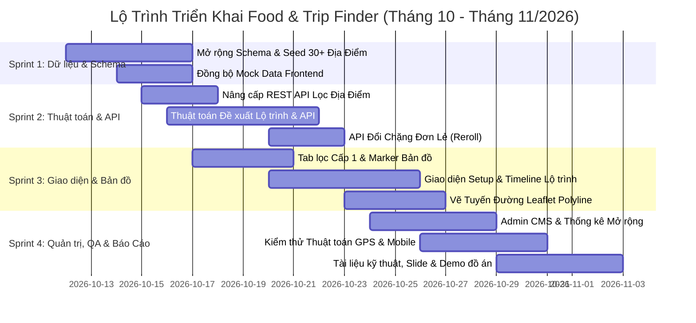

# Kế Hoạch & Tổng Quan Dự Án Food & Trip Finder 🍜🏛️🎡

> **Dự án**: Food & Trip Finder — Nền tảng bản đồ thông minh tích hợp tìm kiếm quán ăn/uống, địa điểm du lịch, khu vui chơi và **Tự động đề xuất lộ trình đi chơi quanh vị trí người dùng**.  
> **Khu vực dữ liệu mẫu**: Quanh Trường Đại học Tôn Đức Thắng (TDTU), Quận 7, TP. Hồ Chí Minh & các điểm du lịch tiêu biểu tại TP.HCM.  
> **Cập nhật ngày**: 11/10/2026.  
> **Tài liệu theo dõi công việc**: [`FoodFinder_Project_Plan.xlsx`](./docs/plan_sheets/FoodFinder_Project_Plan.xlsx) & [`FoodFinder_Project_Plan.csv`](./docs/plan_sheets/FoodFinder_Project_Plan.csv).

---

## 1. TỔNG QUAN ĐỊNH HƯỚNG MỚI (NEW PROJECT SCOPE)

Từ định hướng ban đầu chỉ tập trung vào ẩm thực, dự án được nâng cấp toàn diện thành **Nền tảng Khám phá Thành phố & Lập Lịch Trình Thông Minh**:

1. **Mở rộng Hệ sinh thái Địa điểm (Places Expansion)**:
   * **Ẩm thực & Đồ uống (Food & Beverage 🍜)**: Quán ăn, cà phê, trà sữa, ăn vặt, nhà hàng tiệc nướng, món chay...
   * **Địa điểm Du lịch & Tham quan (Tourism & Sightseeing 🏛️)**: Di tích lịch sử, bảo tàng nghệ thuật, công viên cảnh quan, bến tàu, view ngắm hoàng hôn, cầu biểu tượng...
   * **Khu vui chơi & Trải nghiệm (Entertainment & Activities 🎡)**: Khu trò chơi vận động (trampoline, bowling), rạp chiếu phim, board game cafe, workshop thủ công mỹ nghệ, bắn cung, khu giải trí phức hợp...

2. **Tính năng Đột phá Cốt lõi: Đề xuất Lộ trình Đi chơi Thông minh (Smart Itinerary Generator 🗺️)**:
   * Tự động khởi tạo lịch trình dạo chơi nửa ngày hoặc cả ngày dựa trên **tọa độ GPS thực tế** của người dùng.
   * Kết hợp hài hòa giữa các hoạt động: **Ăn uống khởi đầu -> Tham quan / Vui chơi -> Ăn chính -> Thư giãn / Dạo phố**.
   * Thuật toán tối ưu hóa đường đi liên tục (Nearest Neighbor Heuristic), tránh đi vòng vèo zíc zắc hoặc ngược hướng.
   * Giao diện dòng thời gian (Timeline) trực quan, vẽ đường polyline kết nối các điểm trên nền Leaflet.js và tích hợp nút mở lộ trình đa điểm trực tiếp trên Google Maps.

---

## 2. KIẾN TRÚC & CÔNG NGHỆ (TECH STACK)

### 2.1. Frontend
* **HTML5 Semantic & Modern CSS**: Hệ thống Design Token Neo-Brutalism kết hợp Glassmorphism (`tokens.css`, `brutal.css`, `layout.css`). Hỗ trợ Light / Dark Mode.
* **Vanilla JavaScript ES6+**: Kiến trúc module độc lập (`map.js`, `filters.js`, `explore.js`, `itinerary.js`, `icons.js`...).
* **Bản đồ & Định vị**: Leaflet.js (v1.9.4) + MarkerCluster + OpenStreetMap + HTML5 Geolocation API (fallback TDTU Quận 7).
* **Tuyến đường (Routing Polyline)**: Vẽ đường lộ trình trên bản đồ, tích hợp link Multi-waypoint sang Google Maps (`https://www.google.com/maps/dir/...`).
* **Lưu trữ cục bộ**: LocalStorage lưu quán yêu thích và các lộ trình đã tạo.

### 2.2. Backend & Thuật toán
* **PHP 8.1+ RESTful API**: Cấu trúc nhẹ, không phụ thuộc framework cồng kềnh.
* **Thuật toán Địa lý (Geospatial Computation)**:
  * Bounding Box & Công thức Haversine Distance ($R = 6371.0088\text{ km}$).
  * Bộ lọc giờ mở cửa thực tế (`is_open_now`) hỗ trợ cả địa điểm mở đêm/24/7.
* **Thuật toán Đề xuất Lộ trình Thông minh (`app/itinerary.php`)**:
  * Nhận input: Vị trí xuất phát, Khung thời gian (Nửa ngày / Cả ngày / Buổi tối), Phong cách chuyến đi (Chill, Vui chơi năng động, Check-in sống ảo, Ăn sập), Bán kính.
  * Phân phối logic chặng dừng theo giờ mở cửa, loại hình và khoảng cách liền kề ngắn nhất.
  * Hỗ trợ API đổi chặng đơn lẻ (`api/itinerary_reroll.php`).
* **Bảo mật**: Anti-CSRF token, Session HttpOnly/SameSite, Brute-force IP protection, Upload validation qua MIME type thực tế.

### 2.3. Cơ sở dữ liệu (Database)
* **MySQL / MariaDB** (`utf8mb4_unicode_ci`).
* Mở rộng schema:
  * `places`: Mở rộng từ `restaurants` hoặc bảng chung, bổ sung cột `place_type` (`food`, `tourism`, `entertainment`), `ticket_price`, `estimated_duration` (phút), `best_time_slot`.
  * `categories`: Thêm cột `type_group` để phân nhóm cấp 1 (Ẩm thực, Du lịch, Vui chơi).
  * `itinerary_logs`: Nhật ký các lộ trình được tạo để đo lường KPI & phân tích thói quen người dùng.

---

## 3. FILE KẾ HOẠCH GOOGLE SHEETS & TIẾN ĐỘ THỰC HIỆN

Toàn bộ kế hoạch phân công công việc đã được cấu trúc thành trang tính chuyên nghiệp tại file:
* 📁 **File Excel**: [`FoodFinder_Project_Plan.xlsx`](./docs/plan_sheets/FoodFinder_Project_Plan.xlsx) (Đầy đủ 4 Sheet, định dạng màu sắc Neo-Brutalism, Dropdown Data Validation và Công thức tự động).
* 📁 **File CSV**: [`FoodFinder_Project_Plan.csv`](./docs/plan_sheets/FoodFinder_Project_Plan.csv) (Dùng import nhanh vào bất kỳ phần mềm bảng tính nào).

### 3.1. Hướng Dẫn Tải Lên Google Sheets (Chỉ mất 5 giây)
1. Mở trình duyệt và truy cập: **[sheets.new](https://sheets.new)** (tạo một Google Sheet trắng mới).
2. Trên thanh menu, chọn: **Tệp (File)** > **Mở (Open)** (hoặc phím tắt `Ctrl + O`).
3. Chọn tab **Tải lên (Upload)** và kéo thả file `FoodFinder_Project_Plan.xlsx` từ thư mục dự án vào.
4. Google Sheets sẽ tự động chuyển đổi thành 1 bảng tính Google Sheet trực tuyến hoàn chỉnh với đầy đủ công thức, màu sắc, dropdown và phân quyền chia sẻ cho nhóm!

---

## 4. CHI TIẾT BẢNG PHÂN CÔNG TASK (TASK BREAKDOWN)

| Mã Task | Phân Hệ | Tên Công Việc | Mô Tả & Tiêu Chí Nghiệm Thu | Độ Ưu Tiên | Trạng Thái | Hạn Chót |
| :--- | :--- | :--- | :--- | :---: | :---: | :---: |
| **DB-01** | Database | Mở rộng Schema hỗ trợ Đa loại hình địa điểm | Mở rộng bảng `restaurants` (hoặc `places`) thêm: `place_type` ('food', 'tourism', 'entertainment'), `ticket_price`, `estimated_duration`, `best_time_slot`. | **P1 - Cao** | **Completed ✅** | 14/10/2026 |
| **DB-02** | Database | Mở rộng Bảng Danh Mục theo 3 Nhóm lớn | Thêm `type_group` vào bảng `categories`. Seed danh mục Du lịch (Bảo tàng, Di tích, Công viên) & Vui chơi (Khu trò chơi, Rạp phim, Boardgame, Workshop). | **P1 - Cao** | **Completed ✅** | 14/10/2026 |
| **DB-03** | Database | Thu thập dữ liệu & Seed 30+ Điểm Du lịch & Vui chơi | Soạn `seed_places_expansion.sql` bổ sung 30+ địa điểm thực tế quanh Q7/TPHCM (Cầu Ánh Sao, Hồ Bán Nguyệt, Artinus 3D, Jump Arena, Thảo Cầm Viên, Landmark 81...) kèm GPS, giá vé, giờ mở cửa. | **P1 - Cao** | **Completed ✅** | 16/10/2026 |
| **DB-04** | Frontend | Cập nhật Mock Data Frontend (`mock-data.js`) | Đồng bộ toàn bộ điểm Du lịch và Vui chơi vào `mock-data.js` để app chạy demo tĩnh mượt mà khi chưa bật backend PHP. | **P2 - TB** | To Do | 16/10/2026 |
| **BE-01** | Backend | RESTful API Lấy địa điểm theo loại hình | Nâng cấp `/api/restaurants.php` (hoặc `/api/places.php`) nhận tham số `type=all\|food\|tourism\|entertainment`, `min_price`, `max_price`, tính khoảng cách Haversine. | **P1 - Cao** | **Completed ✅** | 17/10/2026 |
| **BE-02** | Backend | Thiết kế Thuật toán Đề xuất Lộ trình (`app/itinerary.php`) | Xây dựng thuật toán ghép lịch trình: Vị trí hiện tại -> [Ăn sáng/Cafe] -> [Khu vui chơi/Điểm tham quan] -> [Ăn trưa/tối] -> [Chill ngắm cảnh]. Sắp xếp theo khoảng cách ngắn nhất (Nearest Neighbor). | **P1 - Cao** | **Completed ✅** | 20/10/2026 |
| **BE-03** | Backend | Endpoint API Đề xuất Lộ trình (`/api/itinerary.php`) | API nhận: `user_lat`, `user_lng`, `duration` (half_day/full_day/evening), `vibe`, `max_radius`. Trả về JSON: tổng km, tổng giờ dự kiến, danh sách stops kèm thời gian đề xuất. | **P1 - Cao** | **Completed ✅** | 21/10/2026 |
| **BE-04** | Backend | API Đổi Chặng Đơn Lẻ (`/api/itinerary_reroll.php`) | Cho phép đổi 1 địa điểm trong chặng bất kỳ sang địa điểm tương đương gần đó mà không làm xáo trộn các chặng còn lại. | **P2 - TB** | **Completed ✅** | 22/10/2026 |
| **FE-01** | Frontend | Nâng cấp Bộ lọc Nhóm Địa Điểm trên Bản đồ & Explore | Thêm thanh Tabs chọn nhóm: [Tất cả] [🍜 Ẩm thực] [🏛️ Du lịch] [🎡 Vui chơi giải trí] trên `index.html` và `explore.html`. | **P1 - Cao** | To Do | 19/10/2026 |
| **FE-02** | Frontend | Marker & Icon Riêng Biệt cho Từng Loại Địa Điểm | Đỏ/cam cho Quán ăn; Xanh lam cho Du lịch; Vàng/cam neon cho Vui chơi. Cập nhật SVG icon vào `icons.js`. | **P2 - TB** | To Do | 20/10/2026 |
| **FE-03** | Frontend | Cập nhật Thẻ Địa Điểm & Trang Chi Tiết | Hiển thị badge loại địa điểm, giá vé tham quan, thời lượng trải nghiệm đề xuất (Ví dụ: "Thời lượng: ~90 phút"). | **P2 - TB** | To Do | 21/10/2026 |
| **FE-04** | Frontend | Giao diện Thiết lập Lộ trình (Itinerary Setup Modal) | Form chọn: Thời lượng chuyến đi (Nửa ngày / Cả ngày / Tối), Vibe (Chill, Hẹn hò, Trải nghiệm, Ăn sập), Bán kính. Nút "Tạo lộ trình ngay". | **P1 - Cao** | To Do | 23/10/2026 |
| **FE-05** | Frontend | Giao diện Timeline Lịch trình Thông minh | Dòng thời gian trực quan (09:00 -> 11:30...), Thẻ địa điểm, Khoảng cách từng chặng, Nút "Đổi địa điểm khác" (Reroll). | **P1 - Cao** | To Do | 25/10/2026 |
| **FE-06** | Frontend | Vẽ Tuyến Đường Đa Điểm trên Leaflet (Polyline) | Vẽ đường Polyline nối Vị trí người dùng -> Điểm 1 -> Điểm 2 -> Điểm 3... Đánh số thứ tự Marker [1][2][3]. Nút mở toàn bộ lộ trình trên Google Maps. | **P1 - Cao** | To Do | 26/10/2026 |
| **FE-07** | Frontend | Lưu & Chia Sẻ Lộ Trình (LocalStorage & Share) | Lưu các lộ trình đã tạo vào danh sách cá nhân và chia sẻ lộ trình qua Web Share API / Copy Link. | **P3 - Thấp** | To Do | 27/10/2026 |
| **ADM-01** | Admin | Cập nhật Quản Trị Đa Loại Hình trong Admin CMS | Thêm trường chọn Loại hình, giá vé, thời lượng ghé thăm trong trang thêm/sửa địa điểm của Admin CMS. | **P2 - TB** | To Do | 26/10/2026 |
| **ADM-02** | Admin | Thống kê Dashboard Quản Trị Mở Rộng | Cập nhật biểu đồ cơ cấu địa điểm (Ăn uống vs Du lịch vs Vui chơi) và thống kê lượt tạo lộ trình. | **P3 - Thấp** | To Do | 28/10/2026 |
| **QA-01** | QA | Kiểm thử Logic Thuật toán Lộ trình | Test với các toạ độ GPS khác nhau quanh TP.HCM: TDTU Quận 7, Bến Bạch Đằng, Sala Thủ Thiêm; đảm bảo lộ trình hợp lý và không ngược chiều. | **P1 - Cao** | To Do | 28/10/2026 |
| **QA-02** | QA | Kiểm thử Responsive Mobile & Hiệu năng Bản đồ | Kiểm tra trên thiết bị di động thực tế (iOS, Android), thao tác vuốt chạm bản đồ, độ mượt khi zoom và tải nhiều marker/polyline. | **P2 - TB** | To Do | 30/10/2026 |
| **DOC-01** | Docs | Cập nhật Báo Cáo Kỹ Thuật, Sơ Đồ ERD & Thuật Toán | Vẽ sơ đồ hoạt động (Flowchart Lộ trình), sơ đồ Use-Case, cập nhật ERD database và tài liệu API. | **P2 - TB** | To Do | 31/10/2026 |
| **DOC-02** | Docs | Chuẩn bị Slide Thuyết Trình & Kịch bản Demo Đồ án | Thiết kế slide báo cáo tổng kết, kịch bản demo làm nổi bật tính năng gợi ý lịch trình thông minh. | **P2 - TB** | To Do | 02/11/2026 |

---

## 5. LỘ TRÌNH 4 GIAI ĐOẠN (SPRINT TIMELINE)



---

## 6. MA TRẬN PHÂN CÔNG VAI TRÒ (RACI MATRIX)

| STT | Hạng Mục Công Việc | Team Leader | Frontend Dev | Backend Dev | QA & Data Lead |
| :---: | :--- | :---: | :---: | :---: | :---: |
| 1 | Mở rộng CSDL & Dữ liệu 30+ điểm du lịch/vui chơi | **A** | I | **R** | **R** |
| 2 | Thuật toán Đề xuất Lộ trình & Backend API | **A** | C | **R** | C |
| 3 | Giao diện Timeline & Thiết lập Lộ trình | **A** | **R** | C | I |
| 4 | Vẽ tuyến đường Leaflet Polyline & Google Maps Multi-stop | **A** | **R** | C | I |
| 5 | Bộ lọc danh mục cấp 1 & Marker bản đồ tùy biến | **A** | **R** | C | I |
| 6 | Admin CMS Quản trị địa điểm mở rộng | **A** | C | **R** | I |
| 7 | Kiểm thử Thuật toán GPS & Responsive Mobile | **A** | C | C | **R** |
| 8 | Báo cáo đồ án, Slide thuyết trình & Video demo | **R** | C | C | **R** |

*(Ghi chú: **R** = Responsible - Người trực tiếp thực hiện; **A** = Accountable - Người chịu trách nhiệm chính; **C** = Consulted - Người được tham vấn ý kiến; **I** = Informed - Người nhận thông tin).*

---

## 7. BẢN ĐỒ KIẾN THỨC CẦN BIẾT ĐỂ LÀM CHỦ (CONTROL) DỰ ÁN NÀY 🧠

Để tự tin kiểm soát 100%, bảo trì, sửa lỗi và phát triển thêm bất kỳ tính năng nào cho Food Finder, bạn cần trang bị và nắm vững các khối kiến thức sau:

```
┌─────────────────────────────────────────────────────────────────────────────────┐
│                    KHUNG KIẾN THỨC ĐỂ LÀM CHỦ DỰ ÁN FOOD FINDER                 │
├────────────────────────┬────────────────────────┬───────────────────────────────┤
│    1. FRONTEND STACK   │    2. BACKEND & API    │    3. DATABASE & THUẬT TOÁN   │
├────────────────────────┼────────────────────────┼───────────────────────────────┤
│ • ES6+ & ES Modules    │ • PHP 8.1+ Strict Types│ • MySQL / MariaDB (PDO)       │
│ • Leaflet.js & Clusters│ • RESTful API Design   │ • Haversine & Bounding Box    │
│ • Geolocation & Storage│ • Bảo mật: CSRF, Auth  │ • Weighted Random Sampling    │
│ • CSS Tokens & Layout  │ • Upload MIME Check    │ • Quan hệ 1-N, Index tối ưu   │
└────────────────────────┴────────────────────────┴───────────────────────────────┘
```

---

### 4.1. Kiến thức Frontend (Web Client)
1. **JavaScript Hiện đại (ES6+ & ES Modules)**:
   * **Cú pháp module**: Hiểu cách các file kết nối qua `import { ... } from './file.js'` và `export`.
   * **Bất đồng bộ (Async/Await & Fetch API)**: Cách ứng dụng gửi yêu cầu lấy dữ liệu từ Backend (`api.js`).
   * **Cơ chế AbortController**: Hiểu cách ứng dụng hủy bỏ request tìm kiếm cũ khi người dùng gõ từ khóa liên tục, tránh giật lag hoặc phản hồi bị ghi đè.
   * **Xử lý DOM & Sự kiện (Events)**: Bắt sự kiện lọc (Filter), kéo vuốt Bottom Sheet (`sheet.js`), chuyển tab và hiển thị modal.
2. **Bản đồ số & Không gian Địa lý (Leaflet.js)**:
   * **Khởi tạo bản đồ**: `L.map()`, gán tọa độ tâm và mức zoom (`map.js`).
   * **Đánh dấu (Markers) & Cụm địa điểm (MarkerCluster)**: Tạo icon tùy chỉnh (`L.divIcon`), gán tooltip, popup và gom cụm khi zoom xa.
   * **Định vị Geolocation**: Cách dùng `navigator.geolocation.getCurrentPosition()` để lấy GPS thiết bị và cơ chế ghim vị trí mặc định nếu người dùng từ chối cấp quyền.
3. **Quản lý Trạng thái cục bộ (State Management & Storage)**:
   * **LocalStorage**: Lưu danh sách quán yêu thích (`favorites`) và chế độ nền Giao diện Tối/Sáng (`food-finder-theme`).
   * **URLSearchParams**: Đọc và ghi tham số trên thanh địa chỉ (ví dụ: `restaurant.html?id=5`) để chia sẻ liên kết trực tiếp.
4. **CSS Hiện đại & Hệ thống Giao diện (Design System)**:
   * **CSS Custom Properties (Variables)**: Quản lý toàn bộ màu sắc, khoảng cách, bo góc qua biến CSS trong `tokens.css`.
   * **Phong cách Neo-Brutalism + Glassmorphism**: Nắm rõ cách tạo viền đậm, đổ bóng cứng (`box-shadow: 4px 4px 0 #000`) kết hợp mờ kính đục (`backdrop-filter: blur()`).
   * **Responsive Design**: Kỹ thuật Flexbox & Grid, CSS Media Queries thích ứng từ điện thoại đến máy tính.

---

### 4.2. Kiến thức Backend (PHP 8.1+)
1. **PHP Cốt lõi & Kiểu dữ liệu chặt chẽ (Strict Types)**:
   * Khai báo `declare(strict_types=1);` đảm bảo mọi tham số truyền vào hàm phải đúng kiểu dữ liệu (tránh lỗi ngầm).
   * Khối cấu trúc PHP 8+: Match expressions, typed parameters, arrow functions.
2. **Làm việc với Cơ sở dữ liệu qua PDO (PHP Data Objects)**:
   * Sử dụng **Prepared Statements** (`$stmt->prepare()` và `$stmt->bindValue()`) để loại bỏ 100% nguy cơ tấn công SQL Injection.
   * Cơ chế quản lý kết nối Singleton/Helper qua `app/db.php`.
3. **Thiết kế RESTful API**:
   * Chuẩn hóa cấu trúc JSON trả về qua `app/response.php`: luôn có `{ success: true, data: [...] }` hoặc `{ success: false, error: { code, message } }`.
   * Nhận biết và phản hồi đúng HTTP Status Code (200 OK, 400 Bad Request, 404 Not Found, 429 Too Many Requests, 500 Server Error).
4. **Bảo mật Web Ứng dụng**:
   * **Session Security**: Cấu hình phiên làm việc an toàn (`cookie_httponly`, `cookie_samesite=Lax`).
   * **Phòng chống CSRF**: Sinh và kiểm tra CSRF token ngẫu nhiên `bin2hex(random_bytes(32))` ở mọi form sửa đổi dữ liệu (`app/csrf.php`).
   * **Phòng chống Brute-Force**: Giới hạn số lần đăng nhập sai theo IP khách truy cập bằng cách chuyển đổi IP sang nhị phân (`inet_pton`) và khóa tạm trong 15 phút.
   * **Xác thực Mật khẩu**: Cơ chế băm một chiều an toàn với `password_hash($pass, PASSWORD_DEFAULT)` và `password_verify()`.
   * **Upload Tệp an toàn**: Sử dụng tiện ích PHP `finfo` để kiểm tra MIME Type thực tế của tệp ảnh (chống hacker đổi đuôi file `.php` thành `.jpg`).

---

### 4.3. Kiến thức Database & Thuật toán
1. **Cơ sở dữ liệu MySQL / MariaDB**:
   * Thiết kế chuẩn hóa quan hệ 1-N (1 Quán có nhiều Ảnh chi tiết qua `restaurant_images`).
   * Kỹ thuật đánh chỉ mục (Index): Chỉ mục địa lý kép `idx_geo (latitude, longitude)`, chỉ mục tìm kiếm toàn văn `FULLTEXT KEY ft_name_address`.
   * Khóa ngoại kèm ràng buộc toàn vẹn `ON DELETE CASCADE`.
2. **Toán học Không gian Địa lý (Geospatial Math)**:
   * **Bounding Box (`app/geo.php`)**: Lọc phạm vi hình chữ nhật nhỏ trước trong mệnh đề `WHERE` để giảm 95% số bản ghi cần quét.
   * **Công thức Haversine (`app/restaurant_query.php`)**: Tính khoảng cách cung tròn trên mặt cầu Trái Đất chính xác đến từng mét và lọc qua mệnh đề `HAVING distance_km <= :radius`.
3. **Thuật toán Gợi ý ngẫu nhiên có trọng số (Weighted Random Sampling)**:
   * Thay vì chọn ngẫu nhiên đồng đều, hệ thống áp dụng hàm trọng số:
     $$W = \left(0.3 + \frac{\text{rating}}{5}\right) \times e^{-\frac{\text{distance}}{1.5}}$$
   * Quán nào vừa có điểm đánh giá cao vừa ở cự ly gần sẽ có cơ hội được trúng cao hơn rõ rệt.

---

### 4.4. Kiến thức Vận hành & Môi trường Chạy
1. **Môi trường Web Server**:
   * Cách chạy nhanh qua **PHP Built-in Server** (`php -S localhost:8000 -t public`).
   * Cách chạy qua **XAMPP / WampServer** (Apache + MySQL).
2. **Quy tắc phân vùng thư mục an toàn**:
   * Đặt Document Root tại thư mục `public/`.
   * Thư mục `app/` và `database/` nằm ngoài Document Root để không ai có thể xem trộm mã nguồn PHP cấu hình DB từ URL trình duyệt.
3. **Quản lý phiên bản Git**:
   * Quy chuẩn commit và push tự động sau mỗi lần sửa đổi code theo hướng dẫn trong `AGENTS.md`.

---

## 8. HƯỚNG DẪN KIỂM SOÁT TỪNG MODULE: "MUỐN SỬA X THÌ VÀO ĐÂU?" 🧭

| Nhu cầu bạn muốn thay đổi | Các tệp mã nguồn bạn cần chỉnh sửa | Ghi chú kỹ thuật |
| :--- | :--- | :--- |
| **Đổi vị trí mặc định của bản đồ** (ví dụ chuyển từ TDTU Q7 sang Quận 1) | `public/assets/js/config.js`<br>`public/assets/js/geo.js` | Sửa giá trị `DEFAULT_LOCATION: { lat, lng }` |
| **Đổi màu sắc chủ đạo, font chữ hoặc giao diện** | `public/assets/css/tokens.css`<br>`public/assets/css/brutal.css` | Tinh chỉnh các biến `--color-primary`, `--font-sans`, `--shadow-brutal` |
| **Thêm trường mới cho quán ăn** (ví dụ: `has_wifi`, `has_parking`) | 1. `database/schema.sql` (thêm cột)<br>2. `app/restaurant_query.php` (thêm SELECT)<br>3. `public/admin/restaurant_form.php` (thêm ô nhập)<br>4. `public/admin/restaurant_save.php` (lưu DB)<br>5. `public/assets/js/mock-data.js` & `restaurant.js` (hiển thị) | Quy trình đầy đủ từ DB qua Backend ra Frontend |
| **Thay đổi bán kính lọc hoặc mức giá** | `public/assets/js/filters.js`<br>`public/assets/js/config.js` | Điều chỉnh mảng `RADIUS_OPTIONS` hoặc `PRICE_LEVELS` |
| **Sửa công thức chọn quán "Hôm nay ăn gì?"** | `app/geo.php`<br>`public/api/random.php`<br>`public/assets/js/random.js` | Điều chỉnh hệ số trọng số đánh giá hoặc khoảng cách |
| **Thêm API mới (ví dụ API gửi đánh giá)** | 1. Tạo `public/api/ten_api.php`<br>2. Dùng `app/db.php` và `app/response.php`<br>3. Khai báo hàm gọi trong `public/assets/js/api.js` | Chuẩn hóa JSON trả về qua hàm `json_response()` |
| **Đổi tài khoản đăng nhập Admin** | Chạy lại lệnh: `php database/create_admin.php` hoặc sửa bảng `admins` | Mật khẩu luôn phải mã hóa bằng `password_hash()` |

---

## 9. KẾ HOẠCH HÀNH ĐỘNG 7 NGÀY ĐỂ BẠN LÀM CHỦ 100% DỰ ÁN (7-DAY MASTERY PLAN) 📅

Dưới đây là lộ trình bài bản giúp bạn làm chủ toàn bộ dự án từ con số 0:

```
┌────────────────────────────────────────────────────────────────────────┐
│               LỘ TRÌNH 7 NGÀY LÀM CHỦ DỰ ÁN FOOD FINDER                │
└────────────────────────────────────────────────────────────────────────┘
  Ngày 1: Khởi động & Nắm bắt Kiến trúc
     ↓
  Ngày 2: Giải mã Frontend & Bản đồ tương tác
     ↓
  Ngày 3: Phân tích Backend PHP & REST API
     ↓
  Ngày 4: Làm chủ Cơ sở dữ liệu & Thuật toán Geo
     ↓
  Ngày 5: Quản trị Hệ thống Admin CMS & Bảo mật
     ↓
  Ngày 6: Thực hành chỉnh sửa & Thêm tính năng nhỏ
     ↓
  Ngày 7: Hoàn thiện tính năng lớn & Đóng gói triển khai
```

### 🗓️ Ngày 1: Khởi động & Nắm bắt Kiến trúc
* [ ] Đọc kỹ file `README.md` và `PLAN.md`.
* [ ] Chạy file `setup_database.bat` để nạp dữ liệu mẫu vào MySQL (kiểm tra bằng phpMyAdmin).
* [ ] Nhấp đúp `start_server.bat` để chạy server PHP tại `http://localhost:8000`.
* [ ] Trải nghiệm toàn bộ luồng người dùng: Tìm kiếm trên bản đồ `index.html`, mở bộ lọc, quay ngẫu nhiên "Hôm nay ăn gì?", xem chi tiết quán, lưu yêu thích.
* [ ] Đăng nhập trang quản trị tại `http://localhost:8000/admin/` (`admin` / `Admin@123456`) và thử CRUD 1 quán ăn mới.

### 🗓️ Ngày 2: Giải mã Frontend & Bản đồ tương tác
* [ ] Mở `public/assets/js/config.js` để hiểu các thông số cấu hình mặc định (tọa độ GPS, bán kính, API base).
* [ ] Phân tích `public/assets/js/api.js`: Hiểu cách hàm `fetchRestaurants()` tự động fallback sang `mock-data.js` khi CSDL tắt.
* [ ] Phân tích `public/assets/js/map.js`: Xem cách khởi tạo Leaflet map, tạo ghim quán ăn, ghim vị trí người dùng và gom cụm bằng `markerClusterGroup`.
* [ ] Phân tích `public/assets/js/sheet.js`: Tìm hiểu cơ chế vuốt chạm Bottom Sheet mượt mà trên thiết bị di động.

### 🗓️ Ngày 3: Phân tích Backend PHP & REST API
* [ ] Xem `app/db.php`: Cách tạo kết nối PDO với chuẩn UTF-8 và chế độ báo lỗi ngoại lệ.
* [ ] Xem `app/response.php`: Cách tạo response JSON đồng nhất (`json_response`, `json_error`).
* [ ] Xem `public/api/restaurants.php`: Điểm tiếp nhận request từ client, nhận query params và trả danh sách quán.
* [ ] Thử test các API trực tiếp trên trình duyệt hoặc Postman:
  * `http://localhost:8000/api/categories.php`
  * `http://localhost:8000/api/restaurants.php?lat=10.7327&lng=106.6992&radius=2`
  * `http://localhost:8000/api/random.php?lat=10.7327&lng=106.6992`

### 🗓️ Ngày 4: Làm chủ Cơ sở dữ liệu & Thuật toán Geo
* [ ] Đọc `database/schema.sql`: Nắm vững cấu trúc 6 bảng dữ liệu, quan hệ khóa ngoại `ON DELETE CASCADE` và các chỉ mục `INDEX`.
* [ ] Phân tích `app/geo.php` và `app/restaurant_query.php`: Hiểu sâu sắc cách kết hợp **Bounding Box** và **công thức Haversine** trong SQL để tính toán cự ly thực tế cực nhanh.
* [ ] Hiểu cách hệ thống kiểm tra trạng thái quán đang mở cửa (`open_now`) hỗ trợ cả quán mở xuyên đêm qua ngày hôm sau.

### 🗓️ Ngày 5: Quản trị Hệ thống Admin CMS & Bảo mật
* [ ] Phân tích `public/admin/_bootstrap.php`: Tìm hiểu cơ chế kiểm tra phiên đăng nhập (`auth_require_login()`) và bảo vệ chống tấn công CSRF.
* [ ] Phân tích `app/auth.php`: Tìm hiểu cách ghi nhận IP vào bảng `login_attempts` để chặn brute-force sau 5 lần nhập sai.
* [ ] Phân tích `app/upload.php` & `public/admin/restaurant_save.php`: Tìm hiểu quy trình tải ảnh lên an toàn (kiểm tra MIME type, đổi tên ngẫu nhiên chống file shell).

### 🗓️ Ngày 6: Thực hành Tự chỉnh sửa & Tùy biến (Hands-on Practice)
* [ ] **Bài tập thực hành 1**: Đổi vị trí mặc định của bản đồ sang địa chỉ trường học/khu phố quen thuộc của bạn.
* [ ] **Bài tập thực hành 2**: Thêm 1 danh mục món ăn mới (ví dụ: "Trà sữa & Đồ uống") trong trang Admin và gán cho một số quán.
* [ ] **Bài tập thực hành 3**: Tùy biến màu sắc giao diện trong `public/assets/css/tokens.css`.

### 🗓️ Ngày 7: Hoàn thiện tính năng mở rộng & Đóng gói
* [ ] Xây dựng endpoint API nhận đánh giá `POST /api/review.php` kết nối form đánh giá trên `restaurant.html`.
* [ ] Kết nối biểu mẫu chia sẻ quán mới `suggest.html` với cơ sở dữ liệu.
* [ ] Tích hợp tính năng Progressive Web App (PWA) để cài đặt ứng dụng lên màn hình điện thoại.
* [ ] Kiểm tra lại toàn bộ hệ thống và thực hiện commit/push lên GitHub theo quy chuẩn.

---

## 10. KẾT LUẬN & ĐÁNH GIÁ TỔNG QUAN

Dự án **Food Finder** được thiết kế với cấu trúc mã nguồn **rất sạch (clean architecture), module hóa cao và tuân thủ các tiêu chuẩn kỹ thuật hiện đại**:
* **Không phụ thuộc framework nặng nề**: Chạy siêu nhanh, nhẹ và dễ hiểu từ gốc rễ.
* **Cơ chế Fallback thông minh**: Có thể chạy độc lập ở chế độ Mock Data trên giao diện tĩnh hoặc chạy đầy đủ với cơ sở dữ liệu MySQL và REST API.
* **Bảo mật và Hiệu năng được chú trọng**: Có đầy đủ CSRF, Session protection, brute-force guard, upload MIME check, SQL Prepared Statement và thuật toán tối ưu vị trí địa lý.

Nắm vững tài liệu này và hoàn thành lộ trình 7 ngày, bạn sẽ hoàn toàn làm chủ hệ thống, sẵn sàng tự tin bảo vệ đồ án, phỏng vấn hoặc mở rộng ứng dụng thành một sản phẩm thương mại hoàn chỉnh.
